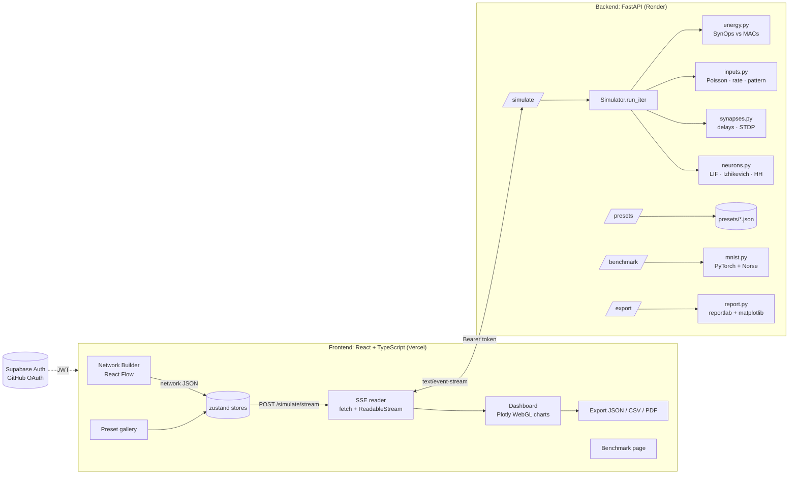

# NeuraSim: an interactive Spiking Neural Network simulator

NeuraSim is a full-stack, browser-based laboratory for **spiking neural networks (SNNs)**, the biologically realistic
"third generation" of neural networks (Maass, 1997). In an SNN, neurons communicate with discrete, all-or-nothing
**spikes** that happen at particular moments in time. Conventional artificial neural networks (ANNs) pass continuous numbers
instead.

With NeuraSim you can:

* **Build** networks visually: drop in neuron populations (Leaky Integrate-and-Fire, Izhikevich, Hodgkin-Huxley),
  input spike trains (Poisson, rate-coded, uploaded patterns) and draw synaptic projections with weights, delays,
  connection probability and optional **STDP** learning.
* **Simulate** them on a Python engine that streams results to the browser with **Server-Sent Events** while the run is
  still in progress.
* **Watch** live WebGL visualisations: spike raster, membrane-voltage traces, a population firing-rate heatmap, STDP
  weight evolution, and an **energy estimate** that compares the SNN's synaptic operations with the multiply-accumulates
  an equivalent ANN would need.
* **Benchmark** a spiking network against a conventional ANN on spike-encoded **MNIST**, comparing accuracy, latency and
  estimated energy, with a plain-English explanation of where the efficiency comes from.
* **Explore** five classic circuits from computational neuroscience: Winner-Take-All, Central Pattern Generator,
  Echo State Network (liquid state machine), STDP learning, and a V1 cortical column.
* **Export** networks as re-importable JSON, spike rasters as CSV, and simulation runs as a PDF report.

It is meant for teaching, for project submissions, and for conference demos, and it is written to be read and
extended.

---

## Contents

1. [Quick start](#1-quick-start)
2. [Spiking neural networks from first principles](#2-spiking-neural-networks-from-first-principles)
3. [Simulator architecture](#3-simulator-architecture)
4. [Using NeuraSim](#4-using-neurasim)
5. [MNIST benchmark: method and results](#5-mnist-benchmark-method-and-results)
6. [API reference](#6-api-reference)
7. [Extending NeuraSim](#7-extending-neurasim)
8. [Deployment (Supabase, Render, Vercel)](#8-deployment-supabase-render-vercel)
9. [Testing](#9-testing)
10. [Limitations and future work](#10-limitations-and-future-work)
11. [References](#11-references)

---

## 1. Quick start

**Requirements:** Python ≥ 3.11 and Node.js ≥ 20.

```bash
# Backend (FastAPI): http://localhost:8000
cd backend
python -m venv .venv
.venv/Scripts/activate          # Windows; on macOS/Linux: source .venv/bin/activate
pip install -r requirements.txt
uvicorn app.main:app --reload --port 8000
```

```bash
# Frontend (Vite + React): http://localhost:5173
cd frontend
npm install
cp .env.example .env.local      # VITE_API_URL defaults to http://localhost:8000
npm run dev
```

Open <http://localhost:5173> and choose **Continue as guest**. Without Supabase keys the app runs in *guest mode*, where
every feature works except GitHub sign-in. See [§8](#8-deployment-supabase-render-vercel) to enable sign-in.

> If port 8000 is taken on your machine, start uvicorn with another `--port` and set `VITE_API_URL` in
> `frontend/.env.local` to match.

To retrain the MNIST benchmark yourself, also install the optional deep-learning stack:

```bash
pip install -r requirements-benchmark.txt --extra-index-url https://download.pytorch.org/whl/cpu
python -m app.benchmark.mnist        # ~1-2 min on a laptop CPU, rewrites app/benchmark/results.json
```

---

## 2. Spiking neural networks from first principles

### 2.1 What a biological neuron does

A neuron is a cell whose membrane separates two salt solutions. Ion pumps keep more Na⁺ outside and more K⁺ inside,
which leaves the inside about **65-70 mV negative** relative to the outside (the *resting potential*). The membrane
behaves like a **capacitor** (the lipid bilayer stores charge) in parallel with a **resistor** (ion channels leak
current). When other neurons excite it, positive current flows in and the voltage rises. When the voltage reaches a
**threshold** (around −50 mV), voltage-gated Na⁺ channels open explosively. The result is a 1-2 ms, ~100 mV excursion
called an **action potential**, or **spike**, which travels down the axon. Afterwards the neuron is briefly
**refractory** and cannot fire again.

Two features of this process matter most for computation:

* **The output is binary and timed.** A spike has a fairly stereotyped shape, so the information is carried by *whether*
  and *when* a neuron spikes. The exact voltage waveform carries little.
* **Integration is leaky.** Inputs add up on the membrane, but the charge leaks away with a time constant τₘ ≈ 10-20 ms.
  Inputs that arrive close together in time therefore count for more than inputs spread out over time.

### 2.2 Three generations of neural networks

Maass (1997) grouped neural network models into three generations:

| Generation | Unit | Output | Example |
|---|---|---|---|
| 1st | McCulloch-Pitts threshold gate | 0/1, no time | Perceptron |
| 2nd | Sigmoid / ReLU unit | Continuous value (≈ firing *rate*) | Today's deep ANNs |
| 3rd | **Spiking neuron** | Spike *times* | SNNs, neuromorphic chips |

He proved that networks of spiking neurons are **at least as computationally powerful** as the earlier generations.
For some functions that depend on spike timing (such as coincidence detection), a spiking network needs far fewer units
than a sigmoidal network computing the same function. Time becomes a resource for computation, and a network can use it
to represent information as well as to process it.

### 2.3 Neuron models in NeuraSim

NeuraSim implements three models that trade biological detail against speed.

**Leaky Integrate-and-Fire (LIF)** (Lapicque, 1907; Gerstner et al., 2014). The membrane is an RC circuit:

$$\tau_m \frac{dV}{dt} = -(V - V_\text{rest}) + I(t) - w, \qquad \text{if } V \ge V_\text{th}: \; V \leftarrow V_\text{reset},\; w \leftarrow w + b$$

After a spike the voltage is clamped for the refractory period `t_ref`. The optional adaptation current *w* (which decays
with time constant τ_w) makes the neuron tire during sustained firing, so its firing rate drops over time. LIF is the
workhorse of large-scale SNNs and of neuromorphic hardware.

**Izhikevich model** (Izhikevich, 2003). Two variables and four parameters (a, b, c, d) reproduce most firing
patterns seen in cortex: regular spiking, bursting, chattering, fast spiking and low-threshold spiking.

$$\dot v = 0.04v^2 + 5v + 140 - u + I, \qquad \dot u = a(bv - u), \qquad v \ge 30\text{ mV} \Rightarrow v \leftarrow c,\; u \leftarrow u + d$$

**Hodgkin-Huxley (HH)** (Hodgkin & Huxley, 1952; Nobel Prize 1963). This model describes the actual ionic conductances
of the squid giant axon, and the action potential *emerges* from the equations instead of being added by a reset rule:

$$C_m \dot V = I - \bar g_\text{Na} m^3 h (V - E_\text{Na}) - \bar g_\text{K} n^4 (V - E_\text{K}) - g_L (V - E_L), \qquad \dot x = \alpha_x(V)(1-x) - \beta_x(V)x$$

for the gating variables x ∈ {m, h, n}. HH is about 100× more expensive than LIF, but it is the gold standard for
biophysical realism.

### 2.4 Synapses, delays and Dale's principle

When a presynaptic spike reaches a synapse, it causes a post-synaptic current that rises quickly and decays
exponentially (time constant τ_syn ≈ 5 ms). Positive weights are **excitatory** (glutamate-like) and negative weights are
**inhibitory** (GABA-like). Real neurons are either excitatory or inhibitory at all their outputs (*Dale's principle*),
so NeuraSim keeps the sign of a projection fixed, even when weights are drawn with random jitter. Each projection also
has an **axonal/synaptic delay**, which matters a great deal for oscillations and for timing-based learning.

### 2.5 How information is encoded in spikes

* **Rate coding:** the information is the number of spikes per second. NeuraSim's *rate-coded* input gives neuron *i* a
  regular rate between a minimum and a maximum, which is how a population can encode a scalar.
* **Poisson coding:** each neuron fires randomly with a given rate (probability *r·dt* per step). The MNIST benchmark
  encodes pixel brightness this way.
* **Temporal coding:** information lies in precise spike times or in synchrony. The *custom pattern* input lets you
  upload exact spike times. The STDP preset shows a neuron picking out the correlated (synchronous) inputs among random
  ones with the same rate.

### 2.6 Learning with spike timing: STDP

Spike-Timing-Dependent Plasticity (Bi & Poo, 1998; Song, Miller & Abbott, 2000) adjusts a synapse according to the
**relative timing** of pre- and postsynaptic spikes:

$$\Delta w = \begin{cases} +A_+ \, e^{-\Delta t/\tau_+} & \Delta t = t_\text{post} - t_\text{pre} > 0 \quad \text{(pre causes post: potentiate)} \\ -A_- \, e^{\Delta t/\tau_-} & \Delta t < 0 \quad \text{(post before pre: depress)} \end{cases}$$

NeuraSim implements the standard online form with exponentially decaying traces. Each presynaptic arrival increments a
trace *x* and depresses the weight by A₋·w_max·*y*. Each postsynaptic spike increments a trace *y* and potentiates the
weight by A₊·w_max·*x*. Weights are clipped to [w_min, w_max]. Hebb's rule is often summarised as "neurons that fire
together wire together"; STDP adds causality to it.

### 2.7 Why SNNs can be so energy-efficient

The human brain runs on about 20 W. A GPU running a large ANN uses hundreds of watts. Three properties of SNNs account
for much of this gap:

1. **Event-driven computation.** A spiking neuron only causes work downstream when it fires. In cortex the typical
   firing rate is a few Hz, so at any moment almost all synapses are idle. An ANN evaluates every connection on every
   input, including inputs that are zeros.
2. **Additions instead of multiplications.** A spike is a 1-bit event, so delivering it means *adding* a weight to the
   target's membrane. No multiplication is needed. In 45 nm CMOS a 32-bit floating-point add costs ≈ 0.9 pJ, while a
   multiply-accumulate costs ≈ 4.6 pJ (Horowitz, 2014).
3. **Co-located memory and compute.** Neuromorphic hardware keeps synaptic weights next to the neurons, which avoids the
   costly memory traffic of the von Neumann architecture.

The neuromorphic idea started with Carver Mead's group. **Mahowald & Douglas (1991)** built the first *silicon neuron*:
an analog VLSI circuit whose transistor physics reproduced the conductance dynamics of real neurons at a tiny fraction of
the power of digital simulation. Its descendants include IBM TrueNorth (Merolla et al., 2014), SpiNNaker (Furber et al.,
2014) and Intel Loihi (Davies et al., 2018).

### 2.8 Training spiking networks

A spike is a step function with zero gradient almost everywhere, which rules out ordinary backpropagation.
**Pfeiffer & Pfeil (2018)** review the main ways around this:

* **ANN-to-SNN conversion:** train a ReLU network and map its activations onto firing rates.
* **Surrogate gradients:** use the true step function in the forward pass and a smooth pseudo-derivative in the backward
  pass (Zenke & Ganguli, 2018; Neftci, Mostafa & Zenke, 2019). NeuraSim's benchmark uses this method.
* **Biologically plausible local rules** such as STDP, which NeuraSim's network simulator implements.

They also point out the open challenge: SNNs only beat ANNs on energy when the data are *sparse and temporal* and the
hardware is *event-driven*. NeuraSim's benchmark is built to show this trade-off honestly.

---

## 3. Simulator architecture



### 3.1 Repository layout

```
neurasim/
├── backend/
│   ├── app/
│   │   ├── main.py              FastAPI app, CORS, router registration
│   │   ├── auth.py              Supabase JWT verification (HS256 secret or JWKS) + guest fallback
│   │   ├── config.py            environment-driven settings and safety limits
│   │   ├── schemas.py           Pydantic network schema (mirrors frontend/src/lib/network.ts)
│   │   ├── engine/
│   │   │   ├── neurons.py       vectorised LIF, Izhikevich, Hodgkin-Huxley
│   │   │   ├── synapses.py      projections: connectivity, delay ring buffers, STDP
│   │   │   ├── inputs.py        Poisson / rate / pattern spike generators
│   │   │   ├── simulator.py     clock-driven loop, streaming event generator
│   │   │   └── energy.py        SNN vs ANN energy model
│   │   ├── routers/             simulate · presets · benchmark · export
│   │   ├── presets/             build.py (source of truth) + generated *.json
│   │   ├── benchmark/           mnist.py + cached results.json
│   │   └── report.py            CSV and PDF generation
│   └── tests/                   pytest suite (dynamics, STDP, delays, SSE, presets, export)
├── frontend/
│   └── src/
│       ├── lib/                 network schema (zod), stores, API/SSE client, auth
│       ├── components/builder/  React Flow canvas, custom nodes/edges, inspector
│       ├── components/viz/      Plotly wrapper and the dashboard charts
│       ├── components/export/   JSON / CSV / PDF buttons
│       └── pages/               Login, Builder, Dashboard, Presets, Benchmark
└── render.yaml                  Render blueprint for the API
```

### 3.2 The network definition (one schema everywhere)

The same versioned JSON document is used by the builder, the presets, JSON export/import and the simulation API. It is
validated by **zod** in the browser and by **Pydantic** on the server.

```jsonc
{
  "version": 1,
  "name": "Starter E/I network",
  "sim": { "dt": 0.1, "duration": 500, "seed": 42, "record_per_population": 5, "chunk_ms": 20 },
  "inputs": [
    { "id": "input", "count": 100, "kind": "poisson", "rate_hz": 15, "start_ms": 0, "stop_ms": null }
  ],
  "populations": [
    { "id": "exc", "label": "Excitatory", "count": 80, "model": "lif",
      "params": { "tau_m": 20, "v_rest": -65, "v_reset": -70, "v_th": -50, "t_ref": 2, "tau_syn": 5 } }
  ],
  "synapses": [
    { "id": "in_exc", "source": "input", "target": "exc", "weight": 5, "p_connect": 0.1, "delay_ms": 1,
      "plasticity": "stdp", "stdp": { "A_plus": 0.01, "A_minus": 0.012, "tau_plus": 20, "tau_minus": 20, "w_min": 0, "w_max": 10 } }
  ]
}
```

**Units.** Time is in ms and voltage in mV. Weight units depend on the *target* model. For LIF targets the current jump
is scaled by τₘ/τ_syn, so a weight *w* gives a post-synaptic potential of roughly *w* mV (≈0.6 *w* for the default time
constants). For Izhikevich and HH targets the weight is the peak synaptic current in the model's native units
(dimensionless I and µA/cm² respectively).

### 3.3 The simulation loop

The engine (`backend/app/engine/simulator.py`) is **clock-driven** with a fixed time step `dt`, and every group is
vectorised with NumPy. Each step does the following:

1. **Inputs** emit spikes.
2. **Projections deliver** the spikes emitted `delay` steps earlier. Each projection keeps a ring buffer of length
   ⌈delay/dt⌉ ≥ 1. Arriving spikes add their weights to the target's exponentially decaying synaptic current. Only the
   rows of neurons that actually fired are touched, so the cost scales with activity. That is where the SynOp count
   comes from, and it reflects the event-driven argument of §2.7. STDP depression is applied on arrival.
3. **Neurons integrate** their total current (synaptic + bias + Gaussian noise) and emit spikes. LIF and Izhikevich use
   forward Euler (Izhikevich with two half-steps for *v*, as in the original paper). HH uses exponential Euler for the
   gating variables and sub-steps the membrane at ≤ 0.025 ms, so it stays stable at dt = 0.1 ms.
4. **Plasticity and buffers:** STDP traces decay, potentiation is applied for postsynaptic spikes, and new spikes are
   written into the delay buffers.

Recording is bounded so that long runs stay light: membrane voltages for the first *k* neurons of each population are
downsampled to at most 2,000 points, with spikes latched so they are never dropped from a trace. Spike recording is
capped at 2 M spikes. Runs are **deterministic** for a given seed, which is why the PDF exporter can re-simulate the
network on the server and reproduce exactly the run shown in the browser.

### 3.4 Streaming protocol (Server-Sent Events)

`POST /simulate/stream?pace_ms=40` responds with `text/event-stream`. The browser cannot `POST` with `EventSource`, so
`frontend/src/lib/api.ts` implements a small SSE parser on top of `fetch` and `ReadableStream`. The stream contains
three kinds of event:

| event | payload |
|---|---|
| `meta` | layout of all groups (global id offsets), recorded neuron ids, thresholds, plastic projections |
| `chunk` (every `chunk_ms`) | spikes `{t[], id[]}`, per-group firing rates, voltage samples, STDP weight means and samples, cumulative SynOps |
| `done` | wall-clock time, total spikes, mean rates, energy estimate, initial/final weight histograms |

The simulator itself is a Python generator. FastAPI advances it in a thread pool, one chunk at a time, and stops if the
client disconnects. `pace_ms` adds an optional delay between chunks so small networks can be watched evolving
("Live" playback). The client appends chunks to its arrays in place and re-renders Plotly at most once per animation
frame (`scattergl`, so rasters with 10⁵-10⁶ points stay smooth).

### 3.5 Energy model

```
SNN energy = SynOps × E_AC         (SynOps = Σ over delivered spikes of the sender's fan-out)
ANN energy = connections × frames × E_MAC   (frames = duration / 1 ms)
```

with E_AC = 0.9 pJ and E_MAC = 4.6 pJ (Horowitz, 2014). The ANN is assumed to process the same temporal stream at 1 kHz
using the same connectivity. The model counts arithmetic only; see [§10](#10-limitations-and-future-work).

### 3.6 Authentication

The frontend calls `supabase.auth.signInWithOAuth({ provider: "github" })` and sends the Supabase access token as a
Bearer token. `backend/app/auth.py` verifies it either with the project's JWKS (asymmetric signing keys) or with the
legacy HS256 secret. With `REQUIRE_AUTH=false` (the default), unauthenticated users are treated as guests, which keeps
local development and public demos frictionless. Signed-in users' names appear on PDF reports.

---

## 4. Using NeuraSim

* **Builder.** Add populations and inputs from the left palette. Drag from a node's right handle onto a population to
  create a synapse. Select anything to edit it in the inspector, and press *Delete* to remove it. Excitatory projections
  are drawn as blue arrows, inhibitory ones end in a red dot, and plastic ones are animated dashes. After a run, nodes
  glow according to their firing rate, and STDP edges show their learned mean weight.
* **Dashboard.** Choose a playback speed and press **Run**. The raster, voltage traces, activity heatmap, weight chart
  and energy panel fill in as the stream arrives. Use **CSV** and **PDF report** to export the finished run.
* **Presets.** Each card explains the circuit and its biological inspiration and lists references. **Open in builder**
  loads it for editing, and **Run** simulates it immediately.

| Preset | What to look for |
|---|---|
| **Winner-Take-All** | The group receiving 32 Hz input dominates; shared inhibition suppresses the 26 Hz and 20 Hz groups. |
| **Central Pattern Generator** | Flexor and extensor half-centres alternate every ~250 ms. The rhythm comes from mutual inhibition and adaptation, with no rhythmic input. |
| **Echo State Network** | A 400-neuron balanced reservoir turns a repeating input sequence into rich, irregular but reproducible activity. |
| **STDP learning** | With identical 20 Hz rates, synapses from the *correlated* afferents strengthen and those from the *random* afferents weaken. |
| **V1 column** | Thalamic input (100-600 ms) drives L4 first, then L2/3, then the bursting L5 output layer. |

* **Import/Export.** **Export JSON** writes the exact network, and **Import** accepts that file or any preset file.

---

## 5. MNIST benchmark: method and results

`backend/app/benchmark/mnist.py` trains two networks with an identical **784-256-10** architecture on the same 30,000
MNIST training images (5 epochs, Adam) and evaluates both on 5,000 test images, on a CPU.

* **ANN:** a ReLU multilayer perceptron on raw pixel intensities.
* **SNN:** each pixel is **Poisson-encoded** into a 32 ms spike train (rate ∝ brightness, at most 200 Hz). A hidden layer
  of **LIF** neurons (Norse `LIFCell`) feeds a non-spiking leaky-integrator readout (`LICell`), and the class with the
  highest peak membrane potential wins. It is trained end-to-end with **surrogate gradients**. If Norse is not installed,
  an equivalent built-in implementation is used.

Results committed in `results.json` (Norse 1.1.0, PyTorch 2.x CPU):

| | ANN | SNN |
|---|---|---|
| Test accuracy | **95.7 %** | 94.5 % |
| Operations / inference | 203,264 MACs | 173,879 SynOps (ACs) |
| Estimated energy / inference | 935 nJ | **157 nJ (≈ 6.0× less)** |
| CPU latency (batched) | **0.001 ms** | 0.185 ms |
| Training time | 1.5 s | 73 s |

**How to read these numbers.** The SNN reaches almost the same accuracy for about one-sixth of the estimated arithmetic
energy, because only bright pixels emit spikes (~660 input spikes per digit) and hidden neurons fire sparsely (~51 Hz, i.e. about 1.6 spikes each per 32 ms digit).
On a CPU, however, the SNN is **slower** and trains more slowly, because conventional hardware has to simulate every one
of its 32 time steps. The energy advantage is realised only on event-driven neuromorphic hardware, and it grows on data
that is naturally sparse and temporal (event cameras, audio, neural recordings). MNIST is a static image dataset and
is close to the worst case for SNNs. The benchmark page explains these points next to the charts.

You can retrain from the UI (**↻ Retrain both**, which streams progress over SSE) when PyTorch is installed on the server,
or by running `python -m app.benchmark.mnist [--epochs 5 --train-size 30000 --timesteps 32 --hidden 256]`.

---

## 6. API reference

Interactive OpenAPI docs are available at `http://localhost:8000/docs`.

| Method | Path | Description |
|---|---|---|
| GET | `/health` | Liveness and whether auth is configured |
| GET | `/me` | Current user (or guest) |
| POST | `/simulate` | Run a network; returns all recorded data as one JSON object |
| POST | `/simulate/stream?pace_ms=0..500` | Run a network, streaming `meta` / `chunk` / `done` SSE events |
| GET | `/presets` | Preset summaries (description, biology, references, stats) |
| GET | `/presets/{id}` | Full preset, including its network |
| GET | `/benchmark` | Cached MNIST benchmark results |
| POST | `/benchmark/run` | Retrain both models (requires PyTorch); SSE `progress` / `done` / `error` |
| POST | `/export/csv` | Spike raster CSV (`time_ms,neuron_id,group,local_index`) |
| POST | `/export/pdf` | PDF report for the network |

Simulation requests are limited by `MAX_NEURONS` (default 5,000) and `MAX_STEPS` (default 20,000, i.e. 2 s at
dt = 0.1 ms). Requests over the limits return HTTP 422 with an explanation.

---

## 7. Extending NeuraSim

**Add a neuron model.**
1. Subclass `NeuronGroup` in `backend/app/engine/neurons.py`. Initialise state arrays in `__init__`, and implement
   `step(current) -> bool spikes` so that it updates `self.v`. Register the class in `MODELS`.
2. Add the name to `NeuronModel` in `schemas.py` and any new parameters to `NeuronParams`.
3. In `frontend/src/lib/network.ts`, add the model to `NEURON_MODELS`, `MODEL_LABELS`, `MODEL_COLORS`, `DEFAULT_PARAMS`
   and `DEFAULT_WEIGHT`, and add its parameter fields to `PopulationPanel` in `components/builder/Inspector.tsx`.
4. Add a dynamics test to `backend/tests/test_engine.py` (for example f-I curve or threshold).

**Add a plasticity rule** (e.g. triplet STDP, homeostatic scaling, reward-modulated STDP).
Extend the `plasticity` literal in both schemas. In `Projection`, initialise the rule's state and hook into
`transmit()` (presynaptic arrival) and `post_update()` (after the target fires). The simulator already records the mean
and a sample of the weights of every plastic projection.

**Add an input type.** Add a branch to `InputGroup.step()` in `engine/inputs.py`, add the kind to `INPUT_KINDS` and its
fields to the zod/Pydantic schemas, and add its fields to `InputPanel`.

**Add a preset.** Write a function in `backend/app/presets/build.py` that returns
`{id, title, tags, references, network}` (the network includes `description` and `biology`), append it to `PRESETS`,
run `python -m app.presets.build`, and add an assertion of its signature behaviour to `tests/test_presets.py`.

**Add a chart.** The stream already carries spikes, rates, voltages and weights. Create a component in
`components/viz/charts.tsx` that reads from `useSimStore` (subscribe to `version` so it re-renders as chunks arrive),
render it with the `Plot` wrapper, and place it in `pages/Dashboard.tsx`. For new per-chunk quantities, add them to the
`chunk` event in `Simulator.run_iter` and to `onChunk` in `lib/simStore.ts`.

**Swap in another engine.** Anything that yields the same `meta` / `chunk` / `done` events can replace
`Simulator.run_iter`. Brian2 or Norse could be wrapped this way (Brian2's `network_operation` can emit chunks), and the
frontend would not need to change.

---

## 8. Deployment (Supabase, Render, Vercel)

**Supabase (GitHub sign-in)**
1. Create a GitHub OAuth app (GitHub → Settings → Developer settings → OAuth Apps). Set the callback URL to
   `https://<project-ref>.supabase.co/auth/v1/callback`.
2. In Supabase → Authentication → Providers, enable **GitHub** and paste the client ID and secret.
3. In Authentication → URL Configuration, add your Vercel URL (and `http://localhost:5173`) to the redirect allow-list.
4. Copy the project URL and anon key into the frontend env, and the project URL (plus the JWT secret if your project
   uses the legacy HS256 secret) into the backend env.

**Backend on Render.** Create a new **Blueprint** from this repository. `render.yaml` defines the `neurasim-api` web
service (`rootDir: backend`). Set `CORS_ORIGINS` to your Vercel URL and set the Supabase variables
(`backend/.env.example` documents all of them). The free plan serves the cached benchmark without PyTorch.

**Frontend on Vercel.** Import the repository with **Root Directory** `frontend`. `vercel.json` sets the Vite build and
the SPA rewrites. Add the environment variables `VITE_API_URL` (your Render URL), `VITE_SUPABASE_URL` and
`VITE_SUPABASE_ANON_KEY`.

| Variable | Where | Purpose |
|---|---|---|
| `VITE_API_URL` | Vercel | Backend base URL |
| `VITE_SUPABASE_URL`, `VITE_SUPABASE_ANON_KEY` | Vercel | Enable GitHub sign-in (guest mode if empty) |
| `SUPABASE_URL` | Render | JWKS verification of access tokens |
| `SUPABASE_JWT_SECRET` | Render | Legacy HS256 verification |
| `REQUIRE_AUTH` | Render | `true` to reject guests |
| `CORS_ORIGINS` | Render | Allowed origins (`*.vercel.app` is always allowed) |
| `MAX_NEURONS`, `MAX_STEPS` | Render | Per-request safety limits |

---

## 9. Testing

```bash
cd backend && python -m pytest        # 26 tests
cd frontend && npm run typecheck && npm run build
```

The backend tests check the dynamics against theory:

* LIF matches the analytic firing rate 1/(t_ref + τ ln(I/(I−ΔV))).
* The refractory period caps the firing rate, and adaptation slows firing.
* Izhikevich RS neurons fire tonically.
* HH is silent at 2 µA/cm² and fires at about 70 Hz at 10 µA/cm².
* STDP potentiates for pre→post spike pairs and depresses for post→pre pairs.
* Delays shift spike arrival by exactly delay/dt steps.
* Runs are deterministic, the SSE stream has the right shape, and invalid networks are rejected.
* Every preset runs and shows its signature behaviour: the winner wins, the CPG alternates, and STDP separates the two
  input groups.
* The CSV and PDF exports are well-formed.

---

## 10. Limitations and future work

* **Energy figures cover arithmetic only.** Memory access and data movement often dominate real energy budgets, and
  neuromorphic chips have their own per-spike routing costs (e.g. ~24 pJ per synaptic op on Loihi). Treat the ratios as
  an illustration of operation-count sparsity, not as hardware measurements.
* **Clock-driven simulation** with forward Euler limits precision for large `dt`. For HH, use dt ≤ 0.05 ms when accuracy
  matters.
* **Dense weight matrices** limit projections to about 30 M potential synapses. Sparse (CSR) storage would allow larger
  networks.
* **Current-based synapses.** Conductance-based synapses, short-term plasticity, triplet STDP and dendrites are natural
  next steps.
* **Server compute.** Simulations run on the API server. A WebAssembly or WebGPU engine could run small networks
  entirely in the browser.

---

## 11. References

**Key papers**

* **Maass, W. (1997).** Networks of spiking neurons: The third generation of neural network models. *Neural Networks*,
  10(9), 1659-1671. <https://doi.org/10.1016/S0893-6080(97)00011-7>
* **Pfeiffer, M., & Pfeil, T. (2018).** Deep learning with spiking neurons: Opportunities and challenges. *Frontiers in
  Neuroscience*, 12, 774. <https://doi.org/10.3389/fnins.2018.00774>
* **Mahowald, M., & Douglas, R. (1991).** A silicon neuron. *Nature*, 354(6354), 515-518.
  <https://doi.org/10.1038/354515a0>

**Neuron models and dynamics**

* Hodgkin, A. L., & Huxley, A. F. (1952). A quantitative description of membrane current and its application to
  conduction and excitation in nerve. *Journal of Physiology*, 117(4), 500-544.
* Izhikevich, E. M. (2003). Simple model of spiking neurons. *IEEE Transactions on Neural Networks*, 14(6), 1569-1572.
* Lapicque, L. (1907). Recherches quantitatives sur l'excitation électrique des nerfs traitée comme une polarisation.
  *Journal de Physiologie et de Pathologie Générale*, 9, 620-635.
* Gerstner, W., Kistler, W. M., Naud, R., & Paninski, L. (2014). *Neuronal Dynamics*. Cambridge University Press.

**Plasticity and coding**

* Bi, G., & Poo, M. (1998). Synaptic modifications in cultured hippocampal neurons: Dependence on spike timing, synaptic
  strength, and postsynaptic cell type. *Journal of Neuroscience*, 18(24), 10464-10472.
* Song, S., Miller, K. D., & Abbott, L. F. (2000). Competitive Hebbian learning through spike-timing-dependent synaptic
  plasticity. *Nature Neuroscience*, 3(9), 919-926.
* Masquelier, T., Guyonneau, R., & Thorpe, S. J. (2008). Spike timing dependent plasticity finds the start of repeating
  patterns in continuous spike trains. *PLoS ONE*, 3(1), e1377.

**Circuits (presets)**

* Brown, T. G. (1911). The intrinsic factors in the act of progression in the mammal. *Proc. R. Soc. B*, 84(572),
  308-319.
* Marder, E., & Bucher, D. (2001). Central pattern generators and the control of rhythmic movements. *Current Biology*,
  11(23), R986-R996.
* Jaeger, H. (2001). The "echo state" approach to analysing and training recurrent neural networks. GMD Report 148.
* Maass, W., Natschläger, T., & Markram, H. (2002). Real-time computing without stable states. *Neural Computation*,
  14(11), 2531-2560.
* Douglas, R. J., & Martin, K. A. C. (2004). Neuronal circuits of the neocortex. *Annual Review of Neuroscience*, 27,
  419-451.
* Potjans, T. C., & Diesmann, M. (2014). The cell-type specific cortical microcircuit. *Cerebral Cortex*, 24(3),
  785-806.

**Training, hardware and energy**

* Zenke, F., & Ganguli, S. (2018). SuperSpike: Supervised learning in multilayer spiking neural networks. *Neural
  Computation*, 30(6), 1514-1541.
* Neftci, E. O., Mostafa, H., & Zenke, F. (2019). Surrogate gradient learning in spiking neural networks. *IEEE Signal
  Processing Magazine*, 36(6), 51-63.
* Roy, K., Jaiswal, A., & Panda, P. (2019). Towards spike-based machine intelligence with neuromorphic computing.
  *Nature*, 575, 607-617.
* Horowitz, M. (2014). Computing's energy problem (and what we can do about it). *IEEE ISSCC*, 10-14.
* Merolla, P. A., et al. (2014). A million spiking-neuron integrated circuit with a scalable communication network and
  interface. *Science*, 345(6197), 668-673.
* Furber, S. B., et al. (2014). The SpiNNaker project. *Proceedings of the IEEE*, 102(5), 652-665.
* Davies, M., et al. (2018). Loihi: A neuromorphic manycore processor with on-chip learning. *IEEE Micro*, 38(1),
  82-99.
* LeCun, Y., Bottou, L., Bengio, Y., & Haffner, P. (1998). Gradient-based learning applied to document recognition.
  *Proceedings of the IEEE*, 86(11), 2278-2324.

**Software**

* Pehle, C., & Pedersen, J. E. (2021). Norse: A deep learning library for spiking neural networks. Zenodo.
  <https://doi.org/10.5281/zenodo.4422025>
* Stimberg, M., Brette, R., & Goodman, D. F. M. (2019). Brian 2, an intuitive and efficient neural simulator. *eLife*,
  8, e47314.
